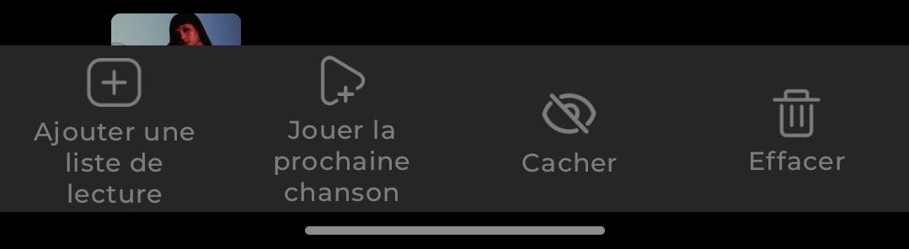

# NovaListen — Conception de l’onglet Bibliothèque

> **Statut :** conception en cours, sans implémentation. Seules les décisions de la section 1 sont confirmées par l’utilisateur. Les recommandations et détails d’ergonomie proposés sont séparés des décisions acquises.
> **Habillage transversal :** le [système de quinze thèmes et de personnalisation supplémentaire](21-systeme-de-themes-visuels.md) s’applique à toute la Bibliothèque : couleurs, typographies, icônes, cartes, panneaux et états. Les rayons des cartes suivent le thème, pas une valeur uniforme issue des captures. Organisation, gestes, formats structurels des images et fonctions acquises restent inchangés ; la déclinaison fine des composants reste à préciser.

## 1. Décisions confirmées

### Une seule vue, consacrée aux morceaux

- L’onglet Bibliothèque présente uniquement les morceaux de la bibliothèque locale.
- Il n’y a pas de deuxième vue Dossiers, ni de bascule « Morceaux / Dossiers ».
- La proposition antérieure de deux vues est abandonnée.

### Filtre global de durée locale — réponse 57 confirmée

- **Un fichier musical de durée connue inférieure à 60 secondes n’apparaît pas dans NovaListen.** Un morceau de **60 secondes exactement** n’est pas exclu par ce critère.
- Appliquer ce filtre lors de l’intégration à la bibliothèque musicale affichée : ne pas réintroduire ces fichiers dans la recherche, les favoris affichés, l’Accueil, les catalogues d’artistes ou d’albums, les résultats de playlists, les compteurs disponibles, les analyses admissibles ou les nouvelles files de lecture.
- **Laisser le fichier intact sur le téléphone** : aucune suppression, aucun déplacement, aucune édition audio ou de métadonnées. Le filtre est distinct de Cacher, Effacer ou Retirer d’une playlist ; il ne vaut pas commande de nettoyage des anciennes références, des favoris enregistrés ou de l’historique.
- **Durée inconnue — réponse 61 acquise :** afficher une entrée **Durée inconnue · en attente**, hors compteurs de morceaux et durées disponibles, et **sans lecture possible** tant que sa durée n’est pas établie. Ne pas l’insérer dans une nouvelle file jouable via toucher, Tout lire ou Lire ensuite ; ne pas contourner le masquage global. Une entrée en attente n’est ni un fichier supprimé, ni un fichier masqué. La lecture des métadonnées et l’attente ne valent pas analyse sonore Nova.
- **Restent ouverts :** identification fiable d’une durée inconnue ou illisible ; style, tri, recherche et actions détaillées des entrées en attente ; réévaluation d’une durée ; anciennes références devenues hors filtre ; effet sur une file déjà lancée ou un titre actif ; sorties et artistes sans morceau admissible. Ne pas déclarer un fichier filtré physiquement supprimé ou indisponible ; aucun saut ou arrêt supplémentaire n’est acquis par analogie avec Cacher.
- Le périmètre est la bibliothèque musicale locale. Les contenus des futurs onglets connectés restent à concevoir séparément ; aucun fichier n’a été inspecté, filtré ou effacé dans cet espace de travail.

### Écoutes d’un fichier devenu inaccessible — réponses 67 et 68

Selon les règles communes de l’[Accueil](01-accueil.md), conserver les événements d’écoutes validées d’un fichier devenu inaccessible, y compris après disparition du fichier. **Masquer leurs lignes dans l’historique normal et signaler leur existence**, sans effacement des événements. **Maintenir leur contribution aux bilans et compteurs historiques**, sans les inclure pour autant dans les compteurs de morceaux disponibles ni les rendre jouables. L’effacement volontaire de l’historique reste une action distincte à concevoir. Ces accords ne choisissent pas encore la contribution des morceaux volontairement masqués ou exclus par durée, ni la réidentification d’un fichier revenu.

### Haut de la Bibliothèque : en-tête, recherche, tri et lecture

L’utilisateur a validé l’ensemble de cette proposition avant de passer à la conception du player et du mini-player. La recherche via une loupe est retenue comme présentation compacte. Les questions explicitement laissées ouvertes ci-dessous restent à arbitrer.

#### Organisation de l’en-tête

- Première ligne : **Bibliothèque** à gauche ; icônes **Recherche** et **Tri** à droite.
- Sous le titre : nombre de morceaux locaux admissibles disponibles non masqués et durée totale correspondante, après le filtre de durée connu d’au moins 60 secondes.
- En dessous : deux commandes **Tout lire** et **Aléatoire**.
- Les lignes de morceaux conservent l’organisation de la capture de référence.
- Aucun sous-onglet ni vue supplémentaire ; une recherche ou un tri agit sur l’unique liste de morceaux.
- Pas de bouton d’actualisation obligatoire dans l’en-tête : l’arrivée de nouveaux fichiers est déjà gérée automatiquement selon la règle confirmée.

#### Recherche

- Toucher l’icône de recherche déploie un champ dans l’en-tête, plutôt qu’une barre permanente.
- Rechercher dans la bibliothèque locale par **titre, artiste, album ou nom du fichier**.
- Affiner les résultats au fil de la saisie, sans modifier les fichiers ni lancer de lecture.
- Ignorer la casse et les accents pour faciliter la recherche.
- Respecter le tri actif ; ne jamais faire apparaître les morceaux masqués dans les résultats ordinaires.
- Afficher le nombre de résultats et leur durée totale pendant une recherche.
- Effacer la recherche restaure la liste complète des morceaux disponibles non masqués.
- Si aucun résultat ne correspond, présenter un message explicite ; ne pas confondre cet état avec une bibliothèque vide.

#### Critères de tri

- **Date d’ajout** — décroissante par défaut, conformément à la décision utilisateur.
- **Titre**.
- **Artiste**.
- **Album**.
- **Durée**.
- **Année** issue des métadonnées musicales, distincte de la date d’ajout.

Chaque critère propose l’ordre croissant/décroissant adapté. Le premier réglage est **date d’ajout décroissante**, puis le dernier tri choisi par l’utilisateur est mémorisé. La source exacte de la date d’ajout et la gestion des valeurs manquantes ou des égalités restent à préciser.

#### Commandes de lecture

- **Tout lire** : démarrer au premier morceau de la liste correspondant à la recherche active et au tri choisi, puis poursuivre dans cet ordre.
- **Aléatoire** : lancer les mêmes résultats dans un ordre mélangé, sans modifier le tri visuel de la Bibliothèque.
- Les deux commandes portent sur **toute la liste correspondante**, pas seulement sur les lignes actuellement visibles ou chargées à l’écran.
- Elles construisent et lancent une nouvelle file en remplacement de la file active ; la nécessité d’une confirmation avant remplacement reste à discuter.
- Une simple recherche ou un changement de tri ne modifie pas la file déjà en lecture.
- Aucun morceau masqué n’entre dans la nouvelle file.
- Sans morceau disponible dans les résultats, désactiver les commandes de lecture.

#### Actualisation pendant la consultation

Actualiser les résultats et compteurs lorsqu’un nouveau fichier est détecté, en respectant la recherche et le tri actifs, sans interrompre la lecture, réinitialiser la saisie, déplacer brutalement la liste ou injecter automatiquement le nouveau morceau dans la file déjà en lecture.

### Présentation de chaque morceau

Chaque ligne de morceau comporte :

- la pochette ;
- le titre ;
- l’artiste ;
- **l’album**, visible directement dans la liste ;
- la durée ;
- un **bouton Favori**, accessible directement sur la ligne, sans ouvrir le menu ;
- un menu d’actions « ⋮ ».

Le morceau en cours de lecture est distingué par un indicateur. L’apparence exacte de cet indicateur reste à définir.

### Organisation visuelle selon la capture fournie

La première capture de l’utilisateur sert de référence à l’organisation de chaque ligne :

- **À gauche :** pochette carrée aux coins arrondis.
- **Au centre :** trois lignes hiérarchisées : titre mis en valeur, artiste, puis album accompagné d’une date séparée par un point.
- **À droite :** durée au-dessus du bouton Favori.
- **À l’extrémité droite :** menu vertical « ⋮ », distinct de la colonne durée/Favori.

La nature exacte de la date affichée n’est pas explicitement nommée. La date d’ajout est une proposition à confirmer ; il ne faut pas la confondre automatiquement avec la date de sortie de l’album.

La référence valide l’organisation, pas nécessairement les couleurs, les polices, les dimensions exactes ou l’usage systématique des majuscules. La pochette et les textes de l’exemple ne sont pas des contenus de démonstration à intégrer à l’application.

### Actualisation automatique à la détection d’un nouveau fichier

- Lorsque NovaListen détecte un nouveau fichier audio accessible et reconnu, la bibliothèque s’actualise automatiquement pour l’intégrer.
- L’utilisateur n’a pas à lancer manuellement une actualisation pour faire apparaître ce nouveau morceau.
- Cette règle concerne l’arrivée de nouveaux fichiers audio ; le traitement automatique des suppressions, déplacements, renommages ou changements de métadonnées n’est pas encore arrêté.

### Gestes sur un morceau

Les directions correspondent au mouvement du doigt.

| Geste confirmé | Action | Effet |
| --- | --- | --- |
| Glisser vers la droite → | **Lire ensuite** | Insère le morceau juste après celui en cours, sans interrompre ce dernier. |
| Glisser vers la gauche ← | **Informations du morceau** | Ouvre les informations du morceau ; ne l’ajoute pas à la file. |
| Appui long | **Sélection multiple** | Active un mode permettant de sélectionner plusieurs morceaux et d’agir sur l’ensemble. |

La précédente proposition « swipe gauche = Ajouter à la file » est remplacée par l’accès aux informations. Dans la Bibliothèque, l’appui long n’ouvre donc plus le menu contextuel proposé auparavant. Le bouton « ⋮ » donne accès au menu individuel décrit plus bas.

Cette décision porte sur la Bibliothèque. Elle ne remplace pas implicitement l’appui long ouvrant un menu décrit dans la fiche de l’Accueil.

### Barre d’actions de sélection multiple

L’utilisateur souhaite une barre d’actions inspirée de sa seconde capture, avec les options suivantes :

1. **Ajouter à une playlist** — libellé clarifié par rapport à « Ajouter une liste de lecture » dans l’image. Le sélecteur propose une ou plusieurs classiques existantes et la création rapide d’une classique contenant les morceaux concernés. Les nouveaux titres sont insérés au début dans leur ordre, en ignorant séparément les fichiers déjà présents dans chaque destination, selon le parcours désormais validé dans la fiche Playlists.
2. **Lire ensuite** — équivalent de l’action « Jouer la prochaine chanson » dans l’image, à appliquer à la sélection.
3. **Cacher**.
4. **Effacer**.

La capture montre une barre inférieure avec icônes et libellés répartis horizontalement. Elle sert de référence à cette organisation, pas à une palette définitive.

Le masquage global de **Cacher** et la suppression réelle d’**Effacer** sont distingués ci-dessous.

### Cacher : masquage global et réversible

- **Cacher s’applique à l’ensemble de NovaListen**, et pas seulement à la Bibliothèque.
- Le morceau masqué est exclu des vues normales de l’application : Accueil et ses modules, Bibliothèque, pages Artistes et Albums, playlists et favoris, recherche et vues de files d’attente.
- Les mixes, recommandations et nouvelles sélections de lecture ne doivent pas faire réapparaître un titre masqué.
- Cette règle concerne le morceau local partout où il est repris dans l’application. Elle devra être respectée par les futurs écrans qui présentent ces morceaux.
- Le masquage est réversible : il ne supprime ni ne déplace le fichier du téléphone.
- Une rubrique dédiée **« Morceaux masqués »** permet de retrouver les titres et de les réafficher ; son emplacement reste à définir.
- L’action est disponible pour un morceau ou pour une sélection multiple.

- Si le morceau actuellement en lecture est masqué, passer **immédiatement au prochain morceau non masqué de la file en cours**, sans attendre la fin du titre masqué.
- S’il n’y a aucun morceau suivant non masqué, **arrêter la lecture**.

Les règles de conservation des données historiques et de calcul des statistiques sont distinctes de cette règle de visibilité.

### Effacer : suppression réelle des fichiers

- **Effacer supprime réellement les fichiers audio du téléphone**, et pas seulement leurs entrées dans la bibliothèque.
- Cette signification s’applique à l’action individuelle du menu « ⋮ » comme à l’action sur une sélection multiple.
- Une confirmation explicite précède la suppression.
- **Références des classiques désormais définies dans la fiche Playlists :** si le fichier est supprimé ou devient inaccessible, conserver ses références mais masquer leurs lignes et signaler les indisponibles, sans les compter comme lisibles. Le sort de l’historique, des favoris et des autres données associées reste à définir séparément.

### Menu individuel « ⋮ »

Le menu reprend les actions de la troisième capture et ajoute les accès à l’album et à l’artiste :

| Action | Rôle confirmé ou point restant à préciser |
| --- | --- |
| **Lire ensuite** | Insérer le morceau juste après celui en cours, sans l’interrompre. Correspond à « Jouer la prochaine chanson » dans la référence. |
| **Ajouter à une playlist** | Ajouter le morceau à une ou plusieurs classiques existantes, ou créer rapidement une classique avec ce morceau, selon le [parcours validé](07-playlists.md). Insérer un nouveau titre au début, sans déplacer son entrée s’il est déjà présent. Correspond à « Ajouter une liste de lecture » dans la référence ; les intelligentes ne sont pas des destinations d’ajout manuel. |
| **Définir comme sonnerie** | Proposer cette action ; son périmètre et le parcours des autorisations Android restent à préciser. |
| **Éditer** | Modifier les métadonnées : titre, artiste, album, pochette, numéro de piste, année et genre. **Les modifications sont enregistrées dans le fichier audio d’origine**, pour être lisibles par d’autres lecteurs compatibles. Il ne s’agit pas d’éditer le son lui-même. Les formats compatibles et autorisations d’écriture devront être vérifiés. |
| **Cacher** | Masquer le morceau dans toute l’application, sans supprimer ni déplacer son fichier. Masquage réversible via la rubrique « Morceaux masqués ». |
| **Effacer** | Supprimer le fichier audio du téléphone, avec confirmation. |
| **Partager** | Proposer le partage du morceau ; les modalités restent à préciser. |
| **Aller dans l’album** | Sélectionner l’onglet **Albums** et ouvrir directement la page de l’album auquel appartient ce titre. |
| **Aller dans l’artiste** | Sélectionner l’onglet **Artistes** et ouvrir directement la page de l’artiste associé au titre. |

Les raccourcis de navigation ne sont donc pas de simples filtres de la Bibliothèque : ils mènent aux pages détaillées dans leurs onglets respectifs.

La référence visuelle montre une feuille ouverte depuis le bas, avec un en-tête pochette/titre/artiste, des actions munies d’icônes et des séparateurs. Elle sert de base de conception. L’ordre final des neuf actions, leur regroupement et le style graphique restent à préciser.

## 2. Recommandations d’actualisation à valider

Ces comportements sont proposés pour rendre l’actualisation discrète et cohérente ; ils ne constituent pas encore des décisions utilisateur.

- À la réouverture ou au retour au premier plan, vérifier automatiquement les changements survenus pendant l’absence de l’application.
- Répercuter les nouveaux titres dans les autres modules concernés, notamment « Ajoutés récemment » sur l’Accueil, selon la règle de date qui sera choisie.

### Limite à prendre en compte lors de la réalisation

La détection dépendra des autorisations accordées, de la disponibilité du fichier dans l’index audio et des restrictions Android. L’objectif est une mise à jour automatique dès que le changement est détectable, et non une promesse de surveillance permanente ou de détection instantanée lorsque l’application est arrêtée par le système.

## 3. Ergonomie et détails proposés — à valider

### Retour visuel des swipes

- Pendant le glissement, révéler l’icône et le libellé de l’action correspondante : Lire ensuite à droite, Informations à gauche.
- Un glissement insuffisant ne valide aucune action.
- La ligne revient à sa place : aucun des deux gestes ne retire le morceau de la bibliothèque.
- Pour « Lire ensuite », afficher une confirmation et permettre d’annuler l’insertion effectuée.
- Ne pas attribuer de suppression de fichier à un swipe.
- Distinguer le geste horizontal du défilement vertical et éviter de gêner le geste de retour du système.
- Prévoir un accès alternatif aux informations, par exemple depuis un menu, pour ne pas imposer l’usage des gestes.

### Informations du morceau

La présentation de cette vue reste à choisir. Contenu proposé, selon les informations effectivement disponibles :

- pochette, titre, artiste, album et durée ;
- dates pertinentes en les nommant explicitement ;
- nom du fichier et emplacement accessible ;
- format, taille et caractéristiques audio disponibles.

Proposition : ouvrir et fermer les informations sans interrompre la lecture. L’action **Éditer**, confirmée dans le menu « ⋮ », porte sur les métadonnées. Son articulation avec cette vue d’informations reste à définir.

### Fonctionnement de la sélection multiple

Proposition de comportement :

- Le morceau sur lequel l’appui long a été effectué est le premier sélectionné.
- Les morceaux sélectionnés sont signalés par une coche ou un état visuel distinct.
- En mode sélection, toucher une autre ligne sélectionne ou désélectionne le morceau au lieu de lancer sa lecture.
- Afficher un compteur, une commande « Tout sélectionner » et une commande pour quitter le mode sélection.
- « Tout sélectionner » concerne la liste correspondant à la recherche ou aux filtres actifs, s’ils existent, et pas seulement les lignes chargées à l’écran.
- La barre inférieure expose les quatre actions de la référence.
- Ajouter à une playlist utilise les destinations déjà validées en section 1 : une ou plusieurs classiques existantes et création rapide d’une classique ; nouveaux titres au début dans leur ordre, ajouts déjà présents ignorés indépendamment pour chaque destination.
- « Lire ensuite » insère la sélection comme un bloc dans l’ordre affiché, sans inverser les titres ni interrompre la lecture.
- Quitter la sélection la vide sans arrêter la musique.
- Neutraliser les swipes et autres actions immédiates sur les lignes pendant la sélection, pour éviter les déclenchements accidentels.
- Les nouveaux fichiers détectés pendant une sélection ne deviennent pas automatiquement sélectionnés, notamment pour éviter de les inclure involontairement dans une action sensible.

### Application du masquage global — détails proposés

Le caractère global et réversible du masquage est confirmé en section 1. Propositions complémentaires :

- Un nouvel indexage, une actualisation de l’Accueil ou la restauration d’une ancienne file ne doit pas réintroduire silencieusement un morceau masqué.
- Conserver en arrière-plan les liens aux favoris et aux playlists ainsi que les données d’écoute, plutôt que de les détruire lors du masquage ; filtrer les titres masqués dans leur présentation normale. Les effets précis sur les compteurs et les agrégats statistiques restent à définir.
- Prévoir une action de réaffichage dans « Morceaux masqués », sans confondre cette gestion avec les listes musicales normales.
- Préciser la présentation des albums et artistes dont tous les morceaux sont masqués.
- Définir avec les onglets connectés les éventuelles correspondances entre un fichier local masqué et un contenu distant distinct ; une équivalence fondée uniquement sur un titre identique n’est pas décidée.

### Effacer — garde-fous proposés

La suppression réelle et sa confirmation sont décidées ; les détails suivants sont des propositions :

- La confirmation nomme clairement la suppression du téléphone et indique le ou les morceaux concernés ainsi que leur nombre.
- Annuler ne supprime aucun fichier.
- Respecter les confirmations ou autorisations exigées par Android.
- Distinguer un succès, un refus d’autorisation et une suppression partiellement réussie, sans annoncer à tort que tous les fichiers ont disparu.
- Après une suppression réussie, actualiser la liste des fichiers disponibles pour que le morceau ne soit plus proposé à la lecture comme s’il était présent. Les références des classiques sont conservées avec lignes masquées et signalement selon la décision de la fiche Playlists ; le sort des données historiques et des autres données associées reste un arbitrage séparé.
- Ne pas promettre une annulation ou une restauration après suppression sans avoir défini et vérifié le mécanisme Android retenu.

### Navigation depuis le menu

Propositions complémentaires :

- Ouvrir l’album ou l’artiste sans lancer de nouvelle lecture ni interrompre celle en cours.
- Préserver la recherche, le tri et la position dans la Bibliothèque pour un éventuel retour.
- Si plusieurs artistes sont réellement associés au titre, permettre de choisir la page à ouvrir ; la gestion des collaborations reste à définir avec l’onglet Artistes.
- Définir un comportement explicite lorsque l’album ou l’artiste est inconnu, plutôt que d’ouvrir une mauvaise page.

### Éditer et définir comme sonnerie

- **Écriture des métadonnées — garde-fous proposés :** l’enregistrement dans le fichier audio d’origine est confirmé en section 1. Vérifier la prise en charge du format et l’autorisation d’écriture ; demander les autorisations nécessaires et afficher une explication si le fichier n’est pas modifiable. Préserver le contenu sonore lors de l’écriture des métadonnées. Ne pas annoncer un enregistrement réussi si l’écriture échoue, ni remplacer silencieusement l’écriture dans le fichier par une correction limitée à NovaListen. Après succès, actualiser les informations affichées et les regroupements concernés dans l’application.
- **Définir comme sonnerie :** préciser le type de sonnerie visé et le parcours d’autorisation. Le résultat dépendra des possibilités Android et de l’accès au fichier ; aucune modification des réglages système ne doit être annoncée comme réussie si elle a été refusée.

### Cas liés aux files encore ouverts

- Comportement de « Lire ensuite » si la file est vide ou si aucun morceau n’est actif.
- Traitement d’un morceau déjà présent : ajout d’une occurrence ou déplacement de l’occurrence existante.
- Ordre de plusieurs opérations « Lire ensuite » successives.
- Possibilité de personnaliser ou de désactiver les gestes.

## 4. Autres éléments encore à définir

- Nature de la date affichée après l’album et source de la date d’ajout utilisée pour le tri.
- Traitement des textes longs, dimensions, couleurs et apparence de l’indicateur de lecture.
- Confirmation éventuelle avant de remplacer la file avec Tout lire ou Aléatoire.
- Gestion des valeurs manquantes ou égales dans les tris et éventuels filtres complémentaires.
- Comportement au toucher simple et constitution de la file lorsqu’un morceau est lancé depuis la Bibliothèque.
- Présentation complète des informations accessibles par swipe gauche.
- Validation des détails d’ergonomie proposés dans la section 3.
- Ordre et regroupement du menu individuel « ⋮ ».
- Formats compatibles avec l’édition des métadonnées, gestion des autorisations d’écriture et sécurisation de l’enregistrement dans le fichier audio d’origine.
- Périmètre de Définir comme sonnerie et modalités du partage.
- Emplacement et ergonomie de la rubrique « Morceaux masqués » et du réaffichage.
- Visibilité des albums/artistes sans titre visible et effet du masquage sur les compteurs et statistiques.
- Conséquences d’une suppression de fichier sur l’historique, les favoris, les autres données de playlists et un éventuel morceau en cours de lecture. La conservation des références devenues indisponibles dans les classiques, avec lignes masquées et signalement, est déjà acquise dans la fiche Playlists.
- Gestion des fichiers devenus indisponibles ou dont les informations changent hors de l’application.
- Gestion des autorisations, premier chargement et états vides.

Les détails des propositions de l’assistant qui ne sont pas confirmés dans la section 1 restent des pistes, pas des exigences acquises.
