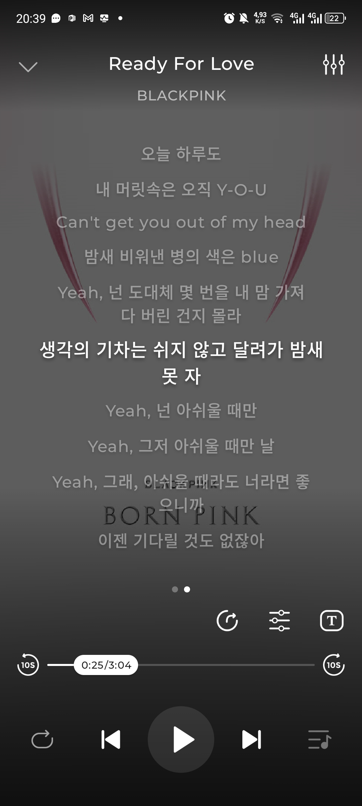

# NovaListen — Player et mini-player

> **Statut :** conception partiellement validée, sans implémentation. Le mini-player est validé. Les états, gestes et règles de maintien de l’écran allumé du player plein écran sont définis par l’utilisateur en section 4, avec trois captures de référence. Les propositions complémentaires et questions ouvertes restent explicitement séparées.
> **Périmètre :** lecture des morceaux locaux. Les possibilités et contraintes des futures sources connectées seront décrites séparément.
> **Habillage transversal :** le [système de quinze thèmes, plus l’option personnalisée](21-systeme-de-themes-visuels.md), transforme mini-player, player et paroles dans l’univers choisi. Il ne réintroduit pas les boutons T-shirt/Cool, ne change ni gestes, ni file, ni délai de 7 secondes, ni maintien d’écran. L’illustration dominante reste acquise ; composition avec fonds/effets et détails des composants sont à maqueter.

## 1. Règles déjà définies à respecter

Ces règles proviennent de la [fiche Bibliothèque](02-bibliotheque.md) :

- « Lire ensuite » place un titre immédiatement après celui en cours, sans interrompre ce dernier.
- Les morceaux masqués sont exclus des vues normales et des sélections musicales dans toute l’application. Le filtre de durée exclut aussi les fichiers locaux de durée connue inférieure à 60 secondes des nouvelles sélections et lectures ; il n’efface pas l’audio et n’est pas Cacher. Une durée inconnue donne une entrée en attente hors compteurs disponibles, sans lecture avant identification ; l’effet d’une réévaluation sur une file déjà lancée reste ouvert.
- Masquer le morceau en lecture fait immédiatement passer au prochain non masqué de la file ; sans suivant admissible, la lecture s’arrête.
- Le menu individuel comprend les actions définies dans la Bibliothèque, dont les raccourcis vers les pages d’album et d’artiste de leurs onglets respectifs.
- « Effacer » signifie supprimer réellement le fichier du téléphone, avec confirmation ; cela ne doit pas être confondu avec retirer un titre d’une file.
- L’édition des métadonnées vise le fichier audio d’origine, selon les autorisations et formats compatibles.

### Comptabilisation commune validée séparément — réponses 53 à 68

Selon les règles communes de l’[Accueil](01-accueil.md), une écoute se valide à **1 minute, soit 60 secondes de temps réellement joué dans un même passage**, y compris une portion réécoutée ; pauses et sauts vers l’avant n’ajoutent rien. Un passage donne au maximum une écoute. Chaque nouveau passage atteignant le seuil peut compter, y compris une relance manuelle ou une boucle Répéter ; un déplacement du curseur seul n’en crée pas un nouveau.

Les lectures non validées ne modifient ni le compteur, ni la dernière écoute statistique, ni le statut Jamais joué des recettes et ne créent pas d’entrée durable dans l’historique consultable. **Une simple pause/reprise conserve le même passage et son cumul**, sans deuxième écoute si le passage est déjà validé. **Après arrêt complet de l’application, une reprise démarre un nouveau passage statistique**, à zéro vers le seuil, même si la position est reprise ; ce n’est pas une simple navigation ou pause. **Horodater au seuil atteint** ; conserver les événements validés sans expiration automatique. Les fenêtres en jours utilisent les dates locales, aujourd’hui et les N−1 dates précédentes ; les regroupements historiques gardent la date, l’heure locale et le fuseau de chaque validation, sans reclassement dans le fuseau actuel. Les événements de fichiers devenus inaccessibles restent conservés et contribuent aux totaux historiques, avec lignes masquées et signalement dans l’historique normal ; ils ne rendent pas ces fichiers jouables. Restent ouverts : identification des durées, réévaluations, autres bornes d’un passage, cas limites calendaires, contribution des morceaux masqués ou hors filtre et effacement volontaire. Ces accords ne valident pas les commandes de répétition proposées, une lecture automatique, la restauration de position ou les capacités d’arrière-plan.

## 2. Principe commun

Le mini-player et le player plein écran sont **deux présentations d’un même lecteur** : ils partagent morceau, position, état lecture/pause, file d’attente et modes de lecture.

- Ouvrir ou réduire le player plein écran ne relance pas le morceau et ne remplace pas la file.
- Le player n’est pas un huitième onglet : il se superpose à la page consultée.
- Sa réduction permet de retrouver l’onglet et la page précédents.

## 3. Mini-player — validé

L’utilisateur a validé la proposition du mini-player avant de décrire le player plein écran. Les références des sections suivantes ne remplacent pas les gestes du mini-player.

### Position et visibilité

- Barre compacte située au-dessus de la navigation principale, quelle que soit la forme retenue pour cette navigation.
- Disponible sur les onglets et pages ordinaires lorsqu’un morceau est chargé, y compris en pause.
- Masqué lorsque le player plein écran est ouvert pour ne pas doubler les commandes.
- Sans morceau chargé, il n’occupe pas d’espace.
- Un morceau masqué ne reste pas représenté dans le mini-player. Si le masquage du titre actif ne laisse aucun suivant, retirer ce titre de l’affichage et revenir à l’état sans morceau actif.
- L’habillage précis — dimensions, arrondis, éventuel effet flottant — reste à finaliser sans remettre en cause cette base fonctionnelle.

### Contenu

- À gauche : petite pochette.
- Au centre : titre et artiste sur deux lignes.
- À droite : Lecture/Pause et Suivant.
- Fine barre de progression, informative par défaut ; le réglage précis de la position se fait dans le player complet.
- Pas de bouton Favori supplémentaire dans le mini-player ; il est accessible dans le player complet.

### Interactions

| Action sur le mini-player | Résultat |
| --- | --- |
| Toucher la pochette ou la zone titre/artiste | Ouvrir le player complet. |
| Toucher Lecture/Pause ou Suivant | Exécuter uniquement la commande, sans ouvrir le player. |
| Glisser le doigt vers le haut ↑ | Ouvrir le player complet. |
| Glisser le doigt vers la gauche ← | Morceau suivant. |
| Glisser le doigt vers la droite → | Morceau précédent. |

Ces gestes sont propres au mini-player. Aucun geste de fermeture, de suppression ou d’appui long ne lui est encore affecté.

## 4. Player plein écran — états et gestes définis

Le player possède une **page principale**, qui alterne entre commandes visibles et mode immersif, et une **page paroles complètes**.

### A. Page principale, commandes visibles — image 1

- À chaque ouverture du player plein écran, afficher cette présentation.
- L’organisation prend pour référence la première capture : illustration en arrière-plan grand format, titre et artiste en haut, aperçu des paroles près des commandes et commandes regroupées dans la partie basse.
- La présence d’une barre de progression, des commandes de transport et des rangées d’actions est reprise comme base d’organisation. Une proposition détaillée d’affectation des boutons figure en section 6 ; les nouveaux choix restent à valider.
- Cette référence remplace la proposition initiale d’une pochette carrée isolée au centre avec les informations uniquement en dessous.

### B. Page principale, mode immersif — image 3

- Après **7 secondes sans interaction tactile**, les commandes du player disparaissent.
- La lecture n’est pas interrompue par ce changement d’affichage.
- La référence est la troisième capture : illustration dominante, titre et artiste, aperçu des paroles et zone de visualisation audio, sans les rangées de boutons ni la barre de progression.
- Le type exact de visualisation audio — onde, spectre, animation ou autre — reste à définir ; aucune méthode de génération n’est encore choisie.
- Le masquage concerne les commandes du lecteur ; il ne définit pas à lui seul le comportement des barres système Android.
- **Un appui simple réaffiche les commandes**. Cet appui ne doit pas être confondu avec une demande de pause ou de changement de morceau.
- Les changements de titre par gestes verticaux sont disponibles dans ce mode : **haut = morceau précédent**, **bas = morceau suivant**.
- Après un swipe vertical, le player **reste en mode immersif** et actualise l’illustration, le titre, l’artiste, les paroles et la visualisation pour le nouveau morceau.

### C. Page paroles complètes — image 2

- **Glisser le doigt vers la droite → depuis la page principale** fait basculer vers la présentation de la deuxième capture.
- Cette présentation montre les paroles sur une grande partie de l’écran, avec mise en valeur de la ligne active et atténuation des autres lignes lorsque des données synchronisées sont disponibles.
- Le morceau et sa position de lecture restent les mêmes : il s’agit d’un changement de page, pas d’un nouveau lancement.
- La capture de référence montre les commandes dans la partie basse à l’arrivée sur cette vue.
- **Les commandes restent visibles sur la page paroles**, même après 7 secondes sans interaction. Le masquage automatique concerne uniquement la page principale.
- **Un swipe vers la gauche ← revient à la page principale avec les commandes visibles**, comme sur l’image 1.

### Tableau récapitulatif des transitions confirmées

Les directions correspondent au mouvement du doigt.

| Contexte | Événement | Résultat |
| --- | --- | --- |
| Ouverture du player | Ouvrir depuis le mini-player | Page principale, commandes visibles — image 1. |
| Page principale, commandes visibles | 7 secondes sans interaction tactile | Mode immersif, commandes masquées — image 3. |
| Page principale, commandes masquées | Appui simple | Réafficher les commandes — image 1. |
| Page principale, commandes masquées | Swipe vers le haut ↑ | Morceau précédent ; rester en mode immersif. |
| Page principale, commandes masquées | Swipe vers le bas ↓ | Morceau suivant ; rester en mode immersif. |
| Page principale | Swipe vers la droite → | Page paroles complètes — image 2. |
| Page paroles complètes | Swipe vers la gauche ← | Page principale, commandes visibles — image 1. |
| Page paroles complètes | 7 secondes sans interaction tactile | Rester sur les paroles, commandes toujours visibles. |

Les gestes verticaux de changement de morceau sont définis **uniquement lorsque les commandes sont masquées sur la page principale**. Ils ne s’appliquent pas implicitement à une liste de paroles à faire défiler, ni aux lignes de la Bibliothèque.

### Maintien de l’écran allumé — confirmé

- Tant que le player plein écran est affiché au premier plan, **empêcher la mise en veille automatique de l’écran**.
- Cette règle s’applique aux deux présentations de la page principale et à la page paroles, y compris lorsque la musique est en pause.
- Les 7 secondes d’inactivité masquent uniquement les commandes de la page principale : elles n’éteignent pas l’écran.
- Lorsque le player est réduit au mini-player ou que l’application passe en arrière-plan, ne plus imposer ce maintien ; les règles normales de veille d’Android reprennent.
- Le verrouillage volontaire par l’utilisateur reste possible. Il ne s’agit ni de bloquer le bouton de verrouillage, ni d’imposer la luminosité maximale.

## 5. Détails d’interaction proposés — à valider

- Sur la page principale uniquement, relancer un délai complet de 7 secondes après une interaction ou après le réaffichage des commandes.
- Ne pas masquer les commandes au milieu d’un déplacement de la barre de progression, d’un toucher maintenu ou pendant l’utilisation d’un menu ou d’une fenêtre de confirmation.
- Réserver le défilement vertical de la page paroles à la consultation des paroles, sans changement accidentel de morceau.
- Prévoir contraste et voile de fond adaptés aux pochettes claires ou chargées ; respecter la réduction des animations.
- Ne pas laisser les gestes du player interférer avec le geste de retour du système.

Ces détails ne modifient pas les gestes déjà validés du mini-player.

## 6. Boutons du player plein écran — décisions et propositions

L’inventaire reste une proposition sauf les modifications explicitement demandées : retrait des boutons T-shirt et Cool, amplification jusqu’à 200 %, recherche et sélection de paroles, traduction française réversible et sauvegarde des enrichissements. Les fonctions déjà décidées dans la Bibliothèque restent cohérentes avec cette fiche. Les objectifs conditionnels de karaoké et de synchronisation automatique sont détaillés dans la fiche Paroles.

Les pictogrammes « T » et flèche circulaire ne suffisent pas à identifier avec certitude les fonctions de l’application de référence. Les emplacements et rôles proposés sont ceux envisagés pour NovaListen. **Les boutons T-shirt coloré et pastille Cool sont retirés**, sans supprimer implicitement la visualisation audio du mode immersif.

### 6.1 En-tête commun

| Bouton ou zone | Fonction proposée |
| --- | --- |
| **Chevron vers le bas, en haut à gauche** | Réduire le player et retrouver la page précédente avec le mini-player, sans arrêter la musique ni modifier la file. Le maintien de l’écran allumé propre au plein écran cesse alors. |
| **Curseurs, en haut à droite** | Ouvrir les réglages audio de NovaListen. Proposition de périmètre : égaliseur, balance et vitesse de lecture ; leurs réglages détaillés et la compatibilité seront définis séparément. Ne pas modifier le fichier audio original par ces effets de lecture. |

Le titre et le nom d’artiste de l’en-tête restent des informations ; aucun nouveau geste de navigation sur ces textes n’est ajouté implicitement. Les accès à l’artiste et à l’album existent dans le menu individuel.

### 6.2 Rangée d’actions de la page principale

| Bouton | Fonction proposée |
| --- | --- |
| **Cœur — Favori** | Ajouter ou retirer le titre des favoris, avec état vide/rempli cohérent avec les autres écrans. Ne pas changer la lecture. |
| **Plus dans un carré — Ajouter à une playlist** | Ouvrir le choix d’une ou plusieurs classiques existantes ou la création rapide d’une classique avec le morceau courant. Ne pas remplacer la file active. |
| **Horloge — Minuterie** | Programmer une mise en pause après une durée choisie ou à la fin du morceau, afficher le temps restant et permettre l’annulation. Ne pas fermer de force l’application. |
| **Menu « ⋮ »** | Ouvrir le menu individuel déjà défini : Lire ensuite, Ajouter à une playlist, Définir comme sonnerie, Éditer, Cacher, Effacer, Partager, Aller dans l’album et Aller dans l’artiste. |

**Destination d’ajout désormais validée :** le sélecteur partagé propose une ou plusieurs classiques et la création rapide d’une classique, selon la [fiche Playlists](07-playlists.md). Insérer les nouveaux titres au début de chaque liste dans leur ordre, sans déplacer les entrées déjà présentes. Cette position dans la playlist ne change pas la règle de Lire ensuite dans la file. Cet accord sur le parcours ne valide pas l’emplacement encore proposé du bouton Plus dans un carré.

**Minuterie et veille :** avec la règle déjà validée, une mise en pause ne suffit pas à éteindre l’écran tant que le player plein écran reste affiché. La proposition ci-dessus ne crée aucune exception silencieuse à cette règle. Un éventuel retour automatique au mini-player à la fin de la minuterie nécessiterait une décision distincte.

Proposition pour les raccourcis du menu : « Aller dans l’album » ou « Aller dans l’artiste » réduit le plein écran puis montre la page ciblée dans son onglet, tout en conservant la lecture et le mini-player. « Effacer » conserve toujours la confirmation et son sens de suppression réelle du fichier.

### 6.3 Position dans le morceau

| Commande | Fonction proposée |
| --- | --- |
| **Reculer de 10 secondes** | Reculer dans le titre courant, sans descendre avant le début. Ne pas confondre cette action avec Précédent. |
| **Barre de progression** | Toucher ou déplacer le curseur pour choisir une position dans le morceau, lorsque le fichier permet ce déplacement. Ne pas changer volontairement de titre par un simple déplacement du curseur. |
| **Avancer de 10 secondes** | Avancer dans le titre courant, sans demander une position au-delà de sa durée. Le passage naturel en fin de morceau dépend des règles de fin de lecture. |

Le compteur temps écoulé/durée totale est un affichage, pas un nouveau bouton. Proposition : ne pas masquer les commandes pendant une manipulation de la progression.

### 6.4 Commandes du bas

Pour conserver les cinq emplacements de la référence, le bouton de gauche donne accès aux modes ; la file d’attente conserve celui de droite.

| Bouton | Fonction proposée |
| --- | --- |
| **Boucle, en bas à gauche — Modes de lecture** | Ouvrir un panneau avec deux choix distincts : aléatoire activé/désactivé **hors contexte d’une playlist intelligente**, et répétition désactivée/toute la file/un morceau. Montrer l’état actif, notamment « 1 » pour la répétition d’un seul titre. Ce panneau est une proposition, plutôt qu’un cycle ambigu entre plusieurs modes. |
| **Précédent** | Passer au morceau précédent selon l’ordre de lecture, en ignorant les titres masqués. Proposition : toujours changer de morceau, sans règle cachée de retour au début après quelques secondes ; cela reste cohérent avec les gestes Précédent déjà définis. |
| **Lecture/Pause** | Suspendre ou reprendre le titre à sa position, sans vider la file. La pause ne désactive pas le maintien de l’écran allumé en plein écran. |
| **Suivant** | Passer au prochain titre admissible de la file en respectant l’ordre de lecture et les ajouts prioritaires. Les cas de début/fin de file seront précisés avec les modes de lecture. |
| **Liste musicale, en bas à droite — File d’attente** | Ouvrir la file en cours sans arrêter la musique. Retirer un titre de cette file ne signifie ni supprimer son fichier ni le masquer. Les possibilités de gestion de la file restent proposées en section 8. |

**Contrainte validée depuis la [fiche Playlists](07-playlists.md) : Aléatoire est absent de toutes les playlists intelligentes.** Le panneau de modes proposé ne doit pas réintroduire cette commande dans leur contexte de lecture, ni leur appliquer silencieusement un mélange hérité d’une autre source. La répétition n’est pas supprimée par cette décision. Le traitement des files ensuite mixtes et la mémorisation/restitution des modes entre sources restent à concevoir.

Hors de cette contrainte, les règles fines de combinaison aléatoire/répétition et les autres cas d’occurrences restent à valider avec la file. Depuis Playlists, chaque nouvelle demande Lire ensuite se place après le titre actif, avant les précédentes, en conservant l’ordre interne du bloc ; les occurrences du même fichier déjà à venir sont déplacées pour le programmer une seule fois à la nouvelle place, sans toucher au titre actif ni au passé. Sans morceau chargé, préparer la file en pause. Les interactions fines avec les modes restent ouvertes ; l’affectation des boutons ne les tranche pas implicitement.

### 6.5 Boutons latéraux près de l’aperçu des paroles — image 1

| Pictogramme | Affectation proposée pour NovaListen |
| --- | --- |
| **Document/T** | Proposition d’accès au panneau **Paroles**, qui regroupe recherche, import/collage, traduction, synchronisation et présentation. Les fonctions demandées sont détaillées dans la fiche Paroles ; cet emplacement précis reste à confirmer. |
| **Haut-parleur avec pourcentage — confirmé** | Ouvrir le volume de lecture avec **amplification jusqu’à 200 %**. Il s’agit d’un effet de lecture de NovaListen, pas d’une réécriture du fichier audio ni d’une modification des volumes sonnerie/alarme. Le réglage initial et les garde-fous sont proposés ci-dessous. |

**Amplification — recommandations à valider :** démarrer à 100 %, afficher le gain choisi et prévoir une protection contre l’écrêtage. Un gain de 200 % peut provoquer saturation ou distorsion ; il ne garantit pas un volume perçu deux fois plus fort. Les possibilités réelles devront être testées sur appareils et sorties audio.

### 6.6 Commandes propres à la page paroles — image 2

| Pictogramme | Affectation proposée pour NovaListen |
| --- | --- |
| **Flèche circulaire** | Recentrer les paroles sur la ligne correspondant à la lecture en cours et reprendre leur suivi automatique. Ne pas relancer le morceau au début. |
| **Curseurs au-dessus de la progression** | Proposition : ouvrir les **paramètres des paroles**, avec recherche multi-API, collage/import, traduction, outils de synchronisation et réglages du texte. Le décalage avance/retard reste accessible dans ce panneau. |
| **Bouton VO/FR, à la place du T — emplacement proposé** | Demander la traduction française si elle manque, puis basculer entre original et traduction sauvegardée. Une seule langue est affichée à la fois, sans changer le morceau ni la position. La fonction est demandée ; ce choix d’emplacement reste à valider. Le style du texte rejoint les paramètres des paroles. |

Sans paroles horodatées, ne pas présenter une estimation comme une synchronisation fournie ou vérifiée. L’utilisateur demande des outils pour créer une synchronisation : leur faisabilité et les niveaux de précision sont détaillés dans la [fiche Paroles](04-paroles.md).

### 6.7 Indicateurs de page et règles communes

- Les deux points indiquent la page active : principale ou paroles. Proposition : les rendre également touchables, avec une zone de contact suffisante, pour offrir une alternative aux swipes.
- L’illustration et les textes ne deviennent pas d’autres boutons de lecture. En mode immersif, un appui simple reste réservé au réaffichage des commandes.
- Les commandes de transport communes ont les mêmes fonctions sur les deux pages.
- Les commandes restent visibles sur la page paroles selon la règle validée ; le délai de 7 secondes concerne seulement la page principale.
- Proposition : tant qu’un panneau de réglages, la file ou une confirmation est activement utilisé, ne pas masquer les contrôles au milieu de l’interaction.
- Les pochettes, paroles et textes visibles dans les captures restent des références utilisateur, pas des contenus de démonstration à distribuer avec l’application.

## 7. Paroles enrichies : recherche, traduction et karaoké

Les exigences fonctionnelles sont décrites dans la [fiche Paroles](04-paroles.md), qui distingue les demandes confirmées, les recommandations et les limites de faisabilité.

- Un bouton de recherche interroge plusieurs API et présente les résultats pour un **choix manuel**, avec indication **Synchro** pour les paroles horodatées.
- En l’absence de résultat, proposer une recherche sur le Web puis le collage de paroles.
- Un bouton traduit en français et remplace le texte original à l’affichage ; le retour à la VO restaure l’original. Les deux versions sont conservées.
- Réutiliser la synchronisation disponible, avec une distinction impérative entre minutage par ligne et mot à mot. Une traduction française sur un audio d’une autre langue ne peut pas être présentée comme un alignement phonétique exact garanti.
- Sauvegarder durablement les paroles choisies, leur traduction et les enrichissements retenus, notamment les pochettes, afin de les retrouver hors ligne. Une parole candidate non choisie ne doit pas remplacer automatiquement celle du morceau.
- Le karaoké mot à mot VO/VF et la création automatique de synchronisation sont des **objectifs conditionnels à étudier et tester**, pas des fonctions déjà réalisées ni une précision garantie.

L’architecture de récupération des paroles et les moteurs de traduction sont désormais retenus pour la conception : ML Kit par défaut en local, Azure Translator standard F0 uniquement sur demande explicite, sans bascule automatique. La fiche Paroles en précise la portée ; conditions d’accès et de droits, intégration, packs, authentification, stockage selon les formats et méthode d’alignement restent à vérifier ou définir avant développement et activation. Aucun essai ou téléchargement n’est lancé par ces choix.

## 8. File d’attente — décisions des playlists et gestion encore à discuter

### Comportements validés depuis les playlists

La [fiche Playlists](07-playlists.md) fixe désormais explicitement :

- toucher un morceau charge toute la playlist admissible dans son ordre, avec ce morceau actif, et conserve les précédents accessibles ;
- Tout lire, le bouton Lecture d’une carte et le toucher d’un morceau remplacent directement la file sans confirmation ; consulter une playlist ne la remplace pas ; cette réponse ne tranche pas les confirmations propres aux autres onglets ;
- une nouvelle demande Lire ensuite passe immédiatement après le titre en cours et avant les demandes antérieures encore en attente, sans interrompre le titre actif ni inverser l’ordre interne d’un ajout de plusieurs titres ;
- si le même fichier figure déjà parmi les titres à venir, déplacer ses occurrences à venir pour le programmer une seule fois à la nouvelle place, sans modifier le morceau actif ou les écoutes passées ;
- sans morceau chargé, Lire ensuite prépare la file en pause, sans démarrer de musique ; ne pas assimiler une lecture simplement en pause avec morceau chargé à ce cas ;
- plusieurs playlists sélectionnées forment un seul bloc dans l’ordre affiché de la grille (gauche à droite, puis haut en bas), en conservant l’ordre interne des listes ;
- les ajouts, retraits et réorganisations d’une classique sont enregistrés pour les lancements suivants, sans modifier la file déjà lancée ; les règles du masquage global et de disponibilité restent applicables. Ce n’est pas une copie des fichiers audio ;
- **supprimer la playlist qui a servi à lancer la session arrête la lecture et vide toute sa file**, pour une classique comme pour une intelligente, même si Lire ensuite y a ajouté d’autres titres. Cette suppression de source est distincte d’une modification du contenu ou d’un recalcul. Les fichiers audio restent sur le téléphone.

Les recalculs d’intelligentes ne modifient pas non plus la file active. Une suppression d’une seule playlist se fait directement avec Annuler temporaire ; plusieurs listes exigent une confirmation préalable. **Annuler restaure uniquement la playlist enregistrée**, sans rétablir la file arrêtée, le morceau ou sa position, et sans reprise de lecture. Les occurrences communes entre plusieurs listes du même nouveau bloc, les autres cas de répétition et les interactions fines avec les modes restent à concevoir. Ces réponses ne tranchent pas implicitement tous les cas des autres sources.

### Vue et gestion proposées

Une vue dédiée permettrait de :

- voir le titre actif et les morceaux suivants ;
- sélectionner un titre à lire ;
- réorganiser les titres à venir ;
- retirer un titre de la file **sans supprimer son fichier, le masquer ni le retirer des playlists**.

Principes proposés :

- Respecter le masquage global dans la file et dans la lecture automatique.
- Préserver la priorité de « Lire ensuite », même si la lecture aléatoire est active.
- Garder les mêmes états de lecture dans la file, le mini-player et le player complet.
- Définir les interactions précises entre réorganisation manuelle, aléatoire, répétition et occurrences multiples d’un même titre.

## 9. Continuité d’écoute — proposition encore à discuter

- Lecture locale en arrière-plan et lorsque l’écran est éteint.
- Commandes multimédias dans la notification Android et sur l’écran verrouillé.
- Prise en charge des commandes compatibles du casque.
- Mise en pause lors d’un débranchement de la sortie audio et gestion des interruptions du système.
- Proposition au redémarrage de l’application : restaurer le dernier contexte en pause, sans lancer spontanément de musique. La conservation exacte de la position et de la file reste à définir.

Ces capacités concernent ici la lecture locale visée. Elles ne présument pas des possibilités de lecture en arrière-plan ou hors ligne d’un service connecté.

## 10. Arbitrages restants

- Mise en œuvre des API de paroles et des moteurs de traduction retenus, droits d’utilisation et de sauvegarde, packs, commande Azure et faisabilité de la synchronisation détaillés dans la fiche Paroles ; fonction précise de la visualisation audio.
- Validation des affectations de boutons encore proposées en section 6, notamment Modes de lecture, minuterie et emplacements des accès Paroles/VO-FR ; réglage initial et garde-fous de l’amplification à 200 %. Les boutons T-shirt et Cool ne font plus partie de la proposition.
- Validation du bouton Précédent toujours dirigé vers le titre précédent, comme proposé en section 6. Le swipe haut immersif vise déjà le morceau précédent selon la demande utilisateur.
- Répétition, aléatoire, fin de file, occurrences communes à plusieurs listes d’un nouveau bloc et autres cas de répétition. Les priorités d’insertion, le déplacement des occurrences déjà à venir, Lire ensuite sans morceau chargé et les autres comportements validés depuis Playlists en section 8 ne sont pas à redemander ; leurs interactions fines avec les modes et les cas propres aux autres sources restent ouverts.
- Traitement d’un player sans morceau actif, notamment après le masquage du dernier titre admissible.
- Dimensions et déclinaison des palettes, typographies, formes et effets du [thème choisi](21-systeme-de-themes-visuels.md) sur le mini-player ; ne pas refaire choisir les quinze univers déjà fournis. La visualisation audio réelle reste distincte du seul style de courbes ou des 28 barres décrites pour Pop Revolution.
