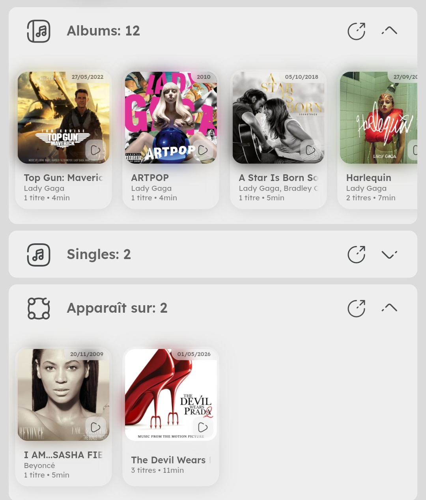

# NovaListen — Conception de l’onglet Artistes

> **Statut :** conception en cours, sans implémentation. Sont définis par l’utilisateur : grille à deux colonnes avec portraits ronds, choix manuel des photos, biographie de trois lignes avec Voir plus, records et biographie hors ligne remplaçable après recherche, boutons de lecture, Top 10 local, bibliothèque personnelle de l’artiste dans une sous-page avec recherche et tri, et rubriques Albums/Singles/Participations. L’ordre global, la portée locale de la discographie et sa présentation en trois blocs repliables à cartes horizontales sont également validés par choix et capture de référence. Les interactions des cartes de sorties sont confirmées : ouverture du détail, lecture locale par le petit bouton et Voir tout par la flèche encerclée. Le Top 10 est classé par nombre d’écoutes personnelles dans NovaListen, du plus écouté au moins écouté. Le menu ⋮ de la page d’artiste et ses cinq actions sont validés ; Lire ensuite et Ajouter à une playlist portent sur tous ses morceaux locaux disponibles et non masqués. L’utilisateur a corrigé l’exclusion proposée des cartes : les gestes droite Lire ensuite, gauche Informations et appui long de sélection multiple s’appliquent aussi aux cartes d’artistes et d’albums. Le socle Wikipédia/Wikidata et français prioritaire puis anglais proposé est retenu pour les biographies et faits de carrière à vérifier ; la cascade photo est désormais validée dans ses rôles conditionnels, son ordre et ses mécanismes d’efficacité. L’admission effective des fournisseurs, les détails de vérification des records, les cas limites de comptabilisation et la période du Top 10 ainsi que les recommandations signalées restent à préciser.
> **Périmètre :** artistes de la collection de l’utilisateur. Le Top 10, la bibliothèque personnelle et les rubriques Albums, Singles et Participations portent **uniquement sur les fichiers et sorties représentés dans sa collection locale**. Cela n’interdit pas l’enrichissement choisi en ligne des photos, biographies et records, ensuite consultables hors ligne.
> **Sources — accords enregistrés :** après l’étude ouverte par « Allons y », « Oui mais pour la photos artiste je veux d'autres piste » retient le [socle de biographies et faits de carrière](18-biographies-portraits-et-records.md) : Wikipédia pour les textes, français prioritaire puis anglais proposé, Wikidata pour l’identité et les faits/records à vérifier. L’utilisateur demande ensuite Last.fm et d’autres sources après son retour sur les photos incorrectes ou anciennes de fanart.tv ; le [comparatif multisource](19-photos-artistes-autres-sources.md) retire la priorité recommandée à fanart.tv. Après présentation de la [cascade photo dédiée](20-cascade-api-photos-artistes.md), **« Je valide », le 17 novembre 2026, retient ses rôles conditionnels, son ordre et ses mécanismes d’efficacité, dont deux requêtes simultanées au total et une cible initiale de six vignettes**. Cette validation ne prouve pas l’accès ou les droits de chaque source et ne rétablit pas les portraits Last.fm. Aucune traduction de biographies, activation ou modification de la structure de page n’est ajoutée.
> **Habillage transversal :** les [quinze univers et l’option de thème personnalisé](21-systeme-de-themes-visuels.md) transforment l’ensemble de cet onglet. Les cartes suivent les rayons/formes du thème, y compris 0 dp ou angles coupés, plutôt que des arrondis uniformes issus des captures. Les portraits ronds, la grille à deux colonnes, l’organisation, les contenus choisis et les fonctions restent acquis ; détails des masques d’images et de composition à préciser.

## 1. Règles existantes à respecter

- **Durée minimale locale acquise — réponse 57 :** exclure les fichiers de durée connue inférieure à 60 secondes des titres et compteurs admissibles, du Top 10, des sorties et des nouvelles lectures. 60 secondes exactement reste admis. Ce filtre n’efface pas les fichiers. La durée inconnue est désormais signalée en attente dans la Bibliothèque, hors compteurs disponibles et sans lecture ; ne pas l’enrôler dans une liste jouable. L’identification fiable, les anciennes références et la présentation d’un artiste ou d’une sortie sans titre admissible restent à définir.

- Le masquage est global : un morceau masqué ne doit pas réapparaître sur une page d’artiste ni dans une lecture lancée depuis cet onglet. Voir la [fiche Bibliothèque](02-bibliotheque.md).
- « Aller dans l’artiste » depuis le menu d’un morceau sélectionne l’onglet Artistes et ouvre directement la page de l’artiste concerné.
- Consulter une page ne doit pas implicitement remplacer la file d’attente ou lancer une nouvelle musique.
- Le [mini-player](03-player-et-mini-player.md) reste disponible pendant la navigation selon ses règles déjà validées.
- Les images choisies et les enrichissements retenus doivent être conservés, selon le principe de persistance décrit dans la [fiche Paroles](04-paroles.md). Les rôles conditionnels des fournisseurs sont retenus dans la [cascade photo validée](20-cascade-api-photos-artistes.md) ; leur admission effective et le stockage technique restent à préciser, avec choix manuel défini en section 7. Elle n’est pas automatiquement une pochette d’album à intégrer aux fichiers.

Les décisions validées ou explicitement demandées sont signalées dans les sections 3, 4, 5 et 7. Les recommandations, emplacements proposés et questions ouvertes ne constituent pas des choix déjà approuvés.

## 2. Organisation de la navigation

1. **Index des artistes** : parcourir et rechercher les artistes présents dans les fichiers locaux.
2. **Page d’un artiste** : consulter biographie et records, Top 10 local, accès à sa bibliothèque personnelle et rubriques Albums, Singles et Participations limitées à la collection locale.
3. **Bibliothèque de l’artiste — sous-page validée** : depuis le bouton dédié de la page d’artiste, afficher tous ses morceaux locaux admissibles, avec recherche et options de tri, en restant dans l’onglet Artistes.

Ces vues ne créent aucun nouvel onglet principal. Le bouton Bibliothèque de l’artiste ne renvoie pas vers la Bibliothèque générale filtrée.

Le contenu des pages de sorties dans l’onglet Albums fait l’objet d’une [fiche dédiée](06-albums.md), actuellement au stade de proposition. Ce passage à la conception d’Albums ne clôt pas implicitement les arbitrages encore ouverts dans la présente fiche.

## 3. Index des artistes

### En-tête

- Titre **Artistes** à gauche.
- Nombre d’artistes affichables sous le titre.
- Icônes Recherche et Tri à droite, dans le même esprit que la Bibliothèque.
- Une recherche porte sur les noms d’artistes et filtre les résultats sans lancer de lecture.
- Pas de commande globale Tout lire sur l’index : les commandes musicales principales sont proposées dans la page de chaque artiste.

### Présentation validée

- **Grille à deux colonnes en portrait**, avec **photos rondes**.
- La présentation en liste compacte n’est pas retenue.

### Contenu et comportement des cartes proposés

- Sous chaque photo : nom de l’artiste, nombre de morceaux et nombre d’albums disponibles localement.
- Si aucune photo n’est disponible, afficher des initiales ou un visuel neutre ; ne pas présenter arbitrairement une pochette d’album comme un portrait certain de l’artiste.
- Toucher une carte ouvre la page de l’artiste ; cela ne lance pas automatiquement sa musique.

Indépendamment de ces propositions de contenu, les gestes sur les cartes sont demandés et décrits en section 5.

### Tris proposés

- **Nom A → Z par défaut**, indépendamment du tri par date d’ajout de la Bibliothèque.
- Ordre inversable.
- Autres critères proposés : nombre de morceaux, dernier ajout parmi les morceaux de l’artiste et dernière écoute lorsque l’historique existe.
- Les critères et la mémorisation des choix restent à valider.

## 4. Page d’un artiste — décisions et propositions complémentaires

### Biographie sous la photo — confirmé

- **Juste sous la photo**, afficher une biographie dont l’aperçu est limité à **trois lignes**.
- Une action **Voir plus** permet de consulter le reste de la biographie et quelques records de l’artiste.
- La biographie et les informations retenues doivent rester consultables **hors ligne**.
- Si la biographie est incorrecte, permettre de **relancer la recherche** puis de choisir une autre réponse parmi les propositions.
- Sauvegarder la nouvelle sélection ; ne pas imposer automatiquement le premier résultat en remplacement du choix utilisateur.

Détails de présentation à préciser et garde-fous du socle artistique retenu :

- Voir plus ouvre une vue de lecture complète ; sa forme — page ou panneau — reste à choisir.
- Identifier la source et la date des informations disponibles, en particulier pour les records susceptibles d’évoluer.
- Ne présenter comme records ou distinctions que des faits attribuables à une source ; ne pas inventer de réalisations lorsqu’aucune donnée n’est disponible.
- Conserver la biographie actuellement enregistrée pendant une nouvelle recherche et ne la remplacer qu’après confirmation d’un résultat.
- Distinguer absence de résultat, erreur de recherche et absence de réseau. Hors ligne, la version sauvegardée reste consultable ; ne pas faire passer un cache ancien pour une nouvelle recherche.
- Ne pas modifier automatiquement les crédits des fichiers audio à partir d’une biographie trouvée.

**Source et langue retenues : Wikipédia, français prioritaire puis anglais proposé** si le français manque ou sur recherche d’une autre version. **Wikidata est retenu pour l’identité et les faits/records à vérifier dans leur contexte**, pas comme certificat universel de records ; une récompense ou une nomination n’est pas automatiquement un record. Les routes, le contenu développé, les catégories/sources et la méthode de vérification des records, les crédits et détails de stockage restent à préciser. Pas de traduction automatique des biographies ajoutée : les traducteurs de paroles ne sont pas étendus par défaut. Les records publics de carrière et les statistiques personnelles d’écoute restent des informations distinctes.

### Commandes et Top 10 — présence, position et critère de classement confirmés

- Afficher les boutons **Tout lire**, **Aléatoire** et **⋮** après les rubriques Albums, Singles et Participations.
- **Juste sous ces boutons**, présenter un **Top 10 des morceaux de l’artiste les plus écoutés par l’utilisateur dans NovaListen**, parmi ceux de sa bibliothèque.
- Les morceaux du Top 10 doivent être locaux, disponibles et non masqués.
- L’utilisateur a reconfirmé que ce **Top 10 se base sur sa bibliothèque personnelle** : ne pas le remplacer par un classement mondial ni y introduire des titres absents de sa collection.

**Critère validé :** classer les titres par **nombre d’écoutes personnelles enregistrées dans NovaListen, en ordre décroissant** — les plus écoutés en premier. Ce classement ne repose ni sur la popularité mondiale ni sur le temps d’écoute cumulé.

La comptabilisation suit désormais les règles communes de l’[Accueil](01-accueil.md) : **1 minute réellement jouée cumulée par passage**, au maximum une écoute par passage, avec relances et boucles Répéter admissibles si elles atteignent le seuil. Les pauses et sauts vers l’avant n’ajoutent pas de temps. La pause simple conserve le passage et son cumul, tandis qu’après arrêt complet de l’application une reprise commence un nouveau passage statistique. L’écoute est datée au moment où la minute est atteinte ; seuls les événements validés figurent durablement dans l’historique, sans expiration automatique. Les fenêtres exprimées en jours suivent les dates locales, aujourd’hui inclus ; les regroupements historiques gardent le fuseau au moment de la validation. Les écoutes de fichiers devenus inaccessibles continuent à contribuer aux bilans et compteurs historiques, sans rendre ces titres admissibles au Top 10 ou à la lecture ; leurs lignes dans l’historique normal sont masquées avec signalement. Aucune durée de référence du Top 10 n’est choisie par ces accords. Restent à définir : la période de calcul, les autres cas limites de comptabilisation et le départage en cas d’égalité. Les morceaux de durée connue inférieure à une minute sont exclus par le filtre global, pas admis avec un seuil réduit. Propositions restantes : s’il y a moins de dix titres admissibles, n’afficher que ceux disponibles ; sans historique, prévoir un état explicite plutôt qu’inventer un classement.

Proposition d’interaction : toucher un titre du Top 10 lance la sélection du Top 10, avec ce titre comme position active. Cette constitution de file reste à confirmer.

### Bouton Bibliothèque de l’artiste — contenu et navigation confirmés

- Le bouton **Bibliothèque de l’artiste** ouvre une **sous-page dans l’onglet Artistes**.
- Cette sous-page contient **tous ses morceaux locaux disponibles et non masqués**, et pas seulement le Top 10.
- Elle dispose d’une **recherche** et des **options de tri**.
- Elle ne redirige pas vers la Bibliothèque générale avec un filtre d’artiste et ne crée pas un huitième onglet principal.
- La consultation de cette liste ne lance pas de musique et ne remplace pas la file d’attente à elle seule, conformément aux règles de navigation déjà définies.

Le bouton est placé **après le Top 10**, conformément à l’ordre choisi. Pour éviter de dupliquer une longue liste, il reste proposé de remplacer l’ancienne section inline Tous les morceaux par cet accès dédié.

### Albums, Singles et Participations — collection locale et présentation validées

L’utilisateur a choisi **uniquement sa collection locale**, et non une discographie en ligne comprenant des sorties absentes du téléphone. Les éventuels fournisseurs peuvent aider à identifier les types de sorties et les crédits, mais ne doivent pas ajouter ici des disques non représentés dans les fichiers locaux.

Les trois rubriques sont :

- **Albums** ;
- **Singles** ;
- **Apparaît sur / Participations** : sorties ou morceaux d’autres artistes sur lesquels il est crédité. La référence utilise le libellé « Apparaît sur ».

#### Structure retenue d’après la capture

- Trois grands blocs arrondis, empilés verticalement, à l’emplacement déjà défini sous la biographie.
- Chaque en-tête comporte une icône de catégorie, son nom et son **nombre de sorties**, un bouton à flèche encerclée **Voir tout** et un chevron.
- Le chevron permet d’ouvrir ou replier la rubrique.
- Les rubriques sont indépendantes : plusieurs peuvent être ouvertes en même temps, comme Albums et Participations dans la capture.
- Une rubrique repliée conserve son en-tête et son compteur.
- Dans chaque rubrique ouverte, une rangée de cartes se parcourt **horizontalement**.
- La référence montre Singles replié ; l’état initial et sa mémorisation ne sont pas encore décidés.
- L’organisation est retenue ; l’habillage des blocs/cartes — formes, rayons, couleurs, typographies, icônes, ombres et animations — suit désormais le [système de thèmes](21-systeme-de-themes-visuels.md). Les arrondis et le fond clair de la capture ne figent pas tous les univers ; la structure et les portraits ronds restent acquis.

#### Contenu visuel des cartes

- Carte et pochette aux coins arrondis.
- Pochette dans la partie haute.
- Badge de date ou d’année en haut à droite de la pochette, lorsqu’une donnée est disponible.
- Petit bouton de lecture superposé en bas à droite de la pochette.
- Sous la pochette : titre mis en valeur, artiste ou artistes associés, puis **nombre de titres locaux et durée totale correspondante** dans une présentation compacte.
- Les noms longs sont tronqués dans la carte plutôt que superposés aux autres informations ; ils restent consultables dans la page détaillée.

Les nombres, dates, textes et pochettes de l’image sont des exemples de référence : ils ne sont pas des valeurs fixes ni des contenus à précharger dans l’application.

#### Interactions validées

Les interactions suivantes sont définies :

- **Toucher la carte**, en dehors du petit bouton de lecture, ouvre la page détaillée de la sortie **dans l’onglet Albums**, sans lancer de musique par cette seule consultation.
- **Toucher le petit bouton de lecture** lance les titres locaux admissibles associés à la carte, sans imposer l’ouverture de la page détaillée.
- **Toucher la flèche encerclée de l’en-tête : Voir tout** ouvre la liste complète de cette catégorie pour cet artiste, au-delà des cartes du carrousel. Ce n’est ni une actualisation ni une recherche de discographie distante.
- Les **gestes droite Lire ensuite, gauche Informations et appui long de sélection multiple s’appliquent aussi aux cartes**, selon la correction utilisateur détaillée en section 5.

La sélection exacte de titres pour **Participations** reste à préciser : uniquement ceux créditant l’artiste consulté ou tous les morceaux locaux de la sortie. La validation des interactions ne tranche pas ce périmètre.

#### Données et comportements encore à préciser

- Proposition : le badge indique la date de sortie musicale, ou seulement l’année si c’est la seule information connue ; ne pas inventer de jour ou de mois. La signification exacte de cette date reste à confirmer.
- Les compteurs d’en-tête comptent les sorties de la catégorie ; ceux des cartes décrivent les titres locaux selon le périmètre qui sera fixé, pas un nombre de pistes téléchargées depuis un catalogue distant.
- Respecter le masquage global dans les titres affichés et les sélections de lecture.
- Définir le tri des cartes, les rubriques sans contenu, la mémorisation du repli et le traitement d’une sortie n’ayant plus de titre visible.
- Utiliser des métadonnées fiables pour distinguer album, single et participation.
- Ne pas qualifier automatiquement de single un album dont un seul morceau est présent localement.
- Le principe de fusion des versions d’un album et les regroupements demandés sont décrits dans la [fiche Albums](06-albums.md). La répercussion de ces regroupements sur les cartes et compteurs de cette page reste à préciser.
- Définir la répartition des EP et mixtapes dans les rubriques de cette page, ainsi que le traitement des compilations et crédits incomplets. Le périmètre Albums / EP / Mixtapes validé pour l’index de l’onglet Albums ne supprime pas les rubriques Singles et Participations de la page d’artiste.

### Ordre d’affichage validé

L’utilisateur a choisi la discographie directement sous la biographie, avant les commandes et le Top 10. L’ordre retenu est :

1. Photo et identification de l’artiste dans l’en-tête.
2. Biographie de trois lignes avec Voir plus.
3. Rubriques Albums, Singles et Participations.
4. Tout lire, Aléatoire et ⋮.
5. Top 10 local.
6. Bouton Bibliothèque de l’artiste.

Les compteurs — morceaux, albums et durée — restent proposés, avec un emplacement à choisir sans intercaler arbitrairement un bloc entre la photo et la biographie demandée juste en dessous.

### Lecture — propositions restantes

- Tout lire et Aléatoire porteraient sur toute la bibliothèque personnelle admissible de l’artiste, pas seulement sur le Top 10. Cette portée doit être confirmée.
- Tout lire suivrait l’ordre de la liste complète ; Aléatoire utiliserait le même ensemble dans un ordre mélangé.
- Les actions concerneraient tous les titres correspondants, pas seulement les lignes chargées à l’écran.
- La confirmation éventuelle de remplacement de la file reste à coordonner avec la Bibliothèque.

### Lignes de morceaux — gestes définis et présentation proposée

- Pour les lignes du Top 10 et de la bibliothèque personnelle : **swipe droite Lire ensuite, swipe gauche Informations et appui long de sélection multiple**.
- L’utilisateur demande que ces gestes s’appliquent **aussi aux cartes d’artistes et d’albums**, et non uniquement aux lignes de morceaux ; voir section 5.
- Proposition distincte : réutiliser également la présentation et les autres actions de la Bibliothèque — pochette, titre, artiste, album/date, durée, Favori et menu. Cette présentation détaillée n’est pas validée par la seule correction sur les gestes.
- Ne pas modifier les règles particulières de l’Accueil.

## 5. Menu d’artiste et gestes sur les cartes

### Menu ⋮ de la page d’artiste — validé

L’utilisateur a validé les cinq actions suivantes dans le menu de la page d’artiste :

1. **Lire ensuite** : insérer les morceaux de la bibliothèque personnelle de l’artiste après le titre en cours, sans interrompre celui-ci. L’ordre des titres, le traitement des doublons et le cas sans titre en cours restent à préciser.
2. **Ajouter à une playlist** : choisir une ou plusieurs classiques existantes ou en créer rapidement une avec les morceaux de sa bibliothèque personnelle, selon le [sélecteur désormais validé](07-playlists.md) ; nouveaux titres au début dans leur ordre, ajouts déjà présents ignorés séparément pour chaque destination. Les intelligentes ne sont pas des destinations d’ajout manuel ; le périmètre des morceaux de l’artiste reste inchangé.
3. **Changer la photo** : afficher plusieurs propositions, laisser choisir et sauvegarder la photo retenue selon les règles déjà validées.
4. **Rechercher une autre biographie** : relancer les recherches et choisir un nouveau résultat, sans imposer le premier.
5. **Informations sur l’artiste** : accéder à la biographie complète et aux records sauvegardés ; l’articulation avec Voir plus reste à préciser.

**Portée validée :** Lire ensuite et Ajouter à une playlist concernent **tous les morceaux locaux disponibles et non masqués de l’artiste**, pas seulement le Top 10. Tout lire et Aléatoire sont déjà visibles sur la page ; ils ne sont pas dupliqués dans ce menu. La validation des actions du menu ne fixe pas encore la portée de ces deux boutons de lecture, qui reste proposée en section 4.

Ne pas ajouter implicitement de suppression de tous ses fichiers, de modification en masse des tags ou de masquage de l’artiste entier sans avoir défini leur portée et les confirmations.

### Gestes sur les cartes d’artistes et d’albums — demandés

**Correction explicite de l’utilisateur : ces gestes s’appliquent aussi aux cartes d’artistes et d’albums.** L’exclusion proposée précédemment est retirée.

| Geste | Carte d’artiste | Carte d’album / de sortie |
| --- | --- | --- |
| Glisser à droite | Lire ensuite les morceaux locaux admissibles de l’artiste. | Lire ensuite les morceaux locaux admissibles de la sortie. |
| Glisser à gauche | Informations sur l’artiste. | Informations sur l’album ou la sortie. |
| Appui long | Activer la sélection multiple de cartes d’artistes. | Activer la sélection multiple de cartes d’albums ou de sorties. |

- Les cartes de sorties concernent notamment celles des rubriques Albums, Singles et Participations. Le périmètre des titres d’une participation reste à préciser en section 4.
- L’appui long sert à **sélectionner les cartes**, pas à ouvrir leur menu ni à lancer leur lecture.
- Les gestes s’ajoutent au toucher simple de navigation et au bouton de lecture déjà définis ; ils ne les remplacent pas.
- Lire ensuite respecte le masquage global et la disponibilité locale. Les détails d’insertion — ordre, doublons, absence de morceau en cours — restent à préciser.
- Le contenu exact des informations d’une sortie et les actions disponibles après sélection de plusieurs cartes restent à définir. Ne pas importer automatiquement Cacher ou Effacer depuis la sélection de morceaux, ni en déduire une suppression de tous les fichiers d’un artiste ou d’un album.
- **Point d’interaction à résoudre :** les rangées d’albums défilent horizontalement et les cartes ont aussi des gestes horizontaux d’action. Concevoir un moyen de les distinguer sans supprimer le défilement ni ignorer les gestes demandés ; aucun mécanisme de reconnaissance n’est encore choisi ou testé.

Aucun épinglage d’artiste à l’Accueil n’est ajouté implicitement aux éléments épinglés déjà définis pour les playlists.

## 6. Identification des artistes et collaborations

Recommandations :

- Utiliser les métadonnées des fichiers locaux et une normalisation prudente des espaces et de la casse.
- Ne pas fusionner sans contrôle des homonymes, pseudonymes ou artistes différents.
- Ne pas découper aveuglément les noms contenant une esperluette, une virgule ou un autre séparateur qui peut appartenir au nom d’un groupe.
- Pour des crédits multiples réellement identifiés, proposer que le morceau apparaisse chez chaque artiste concerné, sans doublon à l’intérieur d’une même page.
- Distinguer au besoin artiste du morceau, artiste d’album et participations ; le périmètre affiché par défaut reste à choisir.
- Regrouper les titres sans métadonnée d’artiste dans **Artiste inconnu**, avec possibilité de corriger les fichiers via l’édition déjà définie.

Le simple texte du titre ou une réponse API ne doit pas entraîner sans validation une réécriture des crédits des fichiers.

## 7. Masquage, images et actualisation

- Recommandation : ne montrer dans l’index que les artistes ayant au moins un morceau local disponible non masqué.
- Si tous les morceaux d’un artiste sont masqués, sa carte n’apparaît plus dans l’index normal ; les données nécessaires à un réaffichage ne sont pas supprimées pour autant. Cette règle de visibilité de l’entité artiste reste à valider.
- Les compteurs et les commandes de lecture suivent le même ensemble de morceaux admissibles.
- Si une page ouverte ne contient plus de morceau visible, afficher un état explicite plutôt que lancer un morceau masqué.
- Un ajout ou une modification de métadonnées doit pouvoir actualiser les regroupements, sans changer la musique en cours par le seul fait de consulter la page.

### Photos d’artistes — choix manuel validé

- Présenter **plusieurs propositions de photos** pour l’artiste concerné.
- L’utilisateur choisit celle à appliquer ; ne pas imposer automatiquement le premier résultat.
- **Sauvegarder localement la photo choisie**, pour qu’elle reste disponible hors ligne et après fermeture de l’application.
- Permettre de la remplacer ensuite par un nouveau choix.
- Une photo d’artiste et une pochette d’album sont des données distinctes : ne pas écraser les pochettes des titres avec le portrait de l’artiste.
- **Ajout demandé : Last.fm**, après le retour « Fanart donne de fausses image ou d'anciennes image ajoute last fm et d'autres sources aussi ». Le [comparatif multisource des photos](19-photos-artistes-autres-sources.md) l’inclut sans promettre un accès automatique : le support documente le retrait des portraits de l’API et ses conditions excluent les images. Une consultation volontaire du site est retenue en principe comme option distincte, sans importation autorisée par ce seul lien ; sa commande reste à concevoir.
- **Rôles photo retenus sous conditions :** Genius, TheAudioDB, Commons, Openverse et Discogs ont les places définies dans la cascade validée ; les sources officielles/kits presse et l’import local autorisé sont des recours volontaires retenus en principe. Leur admission effective, leurs droits, les commandes et le stockage restent à préciser. fanart.tv est retenu en ultime complément admissible seulement, sans retour en priorité ni suppression de son rôle acquis pour les pochettes.
- **Cascade photo validée — « Je valide », 17 novembre 2026 :** la [fiche dédiée](20-cascade-api-photos-artistes.md) retient identité/réutilisation → Genius + TheAudioDB si admissibles → Commons + Openverse → Discogs admissible → fanart.tv admissible en ultime complément → recours manuels volontaires. Last.fm garde un rôle explicite d’identité/réutilisation et de consultation distincte, sans collecte de portraits promise. Sont acquis **deux requêtes simultanées au total pour le parcours photo**, une **cible initiale de six vignettes distinctes**, une découverte initiale bornée à une page ou fiche par fournisseur admissible avec consultation ciblée si nécessaire, résultats progressifs, réutilisation/déduplication/cache compatibles et arrêt des travaux inutiles. La poursuite volontaire de type Plus de photos est retenue en principe, sans libellé ou emplacement imposé. Ce plafond est validé spécifiquement pour les photos, pas étendu automatiquement depuis les métadonnées/pochettes ni aux paroles ; aucune activation.
- **Qualité et actualité :** les principes de contrôle d’identité/type d’image, provenance, doublons et dates sont retenus dans la cascade, sans certification du visage ni de la récence. Date d’ajout chez un fournisseur ≠ date de prise de vue ; si elle est inconnue, indiquer Date inconnue. Les seuils, filtres/tri, rejet de candidat et détails d’interface restent proposés, sans reconnaissance faciale.
- Conserver le choix utilisateur lors des réindexations et des recherches, plutôt que le remplacer silencieusement par une nouvelle image trouvée. Les détails de sauvegarde et d’actualisation restent à concevoir.

## 8. Choix à discuter

- Dimensions et espacements de la grille, et traitement des noms longs.
- Contenu des cartes et tri initial proposé.
- Périmètre de lecture des participations, date affichée, tri des cartes, état initial et mémorisation du repli des rubriques ; les trois interactions carte/lecture/Voir tout sont désormais validées.
- Traitement des collaborations, artistes d’album et participations.
- Détails d’insertion pour Lire ensuite — ordre, doublons et cas sans titre en cours — et articulation d’Informations sur l’artiste avec Voir plus ; les cinq actions du menu et la portée de ses deux actions musicales sont validées.
- Actions de sélection multiple de cartes, contenu des informations d’une sortie et distinction entre défilement horizontal des carrousels et gestes d’action sur les cartes ; l’application des trois gestes aux cartes est demandée.
- Visibilité d’un artiste dont tous les morceaux sont masqués.
- Période de calcul du Top 10, cas limites de la comptabilisation commune, départage des égalités et état sans historique ; le classement par nombre d’écoutes personnelles décroissant et le socle de comptabilisation et de conservation des réponses 53 à 68 sont acquis.
- Portée des boutons Tout lire et Aléatoire, constitution de la file depuis le Top 10 et présentation détaillée des lignes de morceaux ; les gestes sont définis, et la bibliothèque personnelle en sous-page dans Artistes, avec recherche et tri, est validée.
- Admission effective des fournisseurs photo, droits de sauvegarde et cadrage, dimensions, commandes/interface de poursuite ou d’import, seuils détaillés, filtres/tri/rejets, cache, délais et articulation entre cascades ; catégories/sources et méthode de vérification des records, détails de biographies. La réponse 73 impose des API **gratuites uniquement**, sans abonnement ni appels facturés ni bascule automatique vers du payant. Le [cadre API](13-api-et-enrichissements.md) et le [socle artistique retenu](18-biographies-portraits-et-records.md) conservent **Wikipédia, Wikidata et français prioritaire puis anglais proposé** comme acquis ; ne pas les redemander. La [cascade photo validée](20-cascade-api-photos-artistes.md) fixe désormais les rôles conditionnels, l’ordre, les mécanismes d’efficacité, le plafond de deux requêtes simultanées au total, la cible initiale de six vignettes et la borne de découverte ; ce ne sont plus des choix ouverts. Last.fm reste inclus sans accès API de portraits rétabli, fanart.tv en dernier complément admissible, et le [comparatif multisource photo](19-photos-artistes-autres-sources.md) conserve les réserves documentaires. L’usage personnel est réaffirmé, sans accès ou droit d’image universel ajouté. Un record reste distinct d’une récompense et des écoutes personnelles ; aucune API exhaustive ni traduction automatique des biographies n’est choisie.
